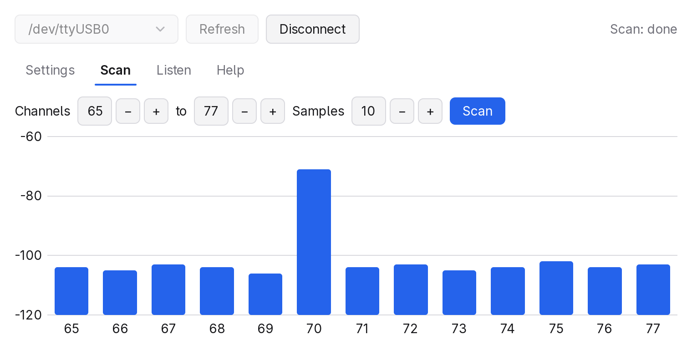
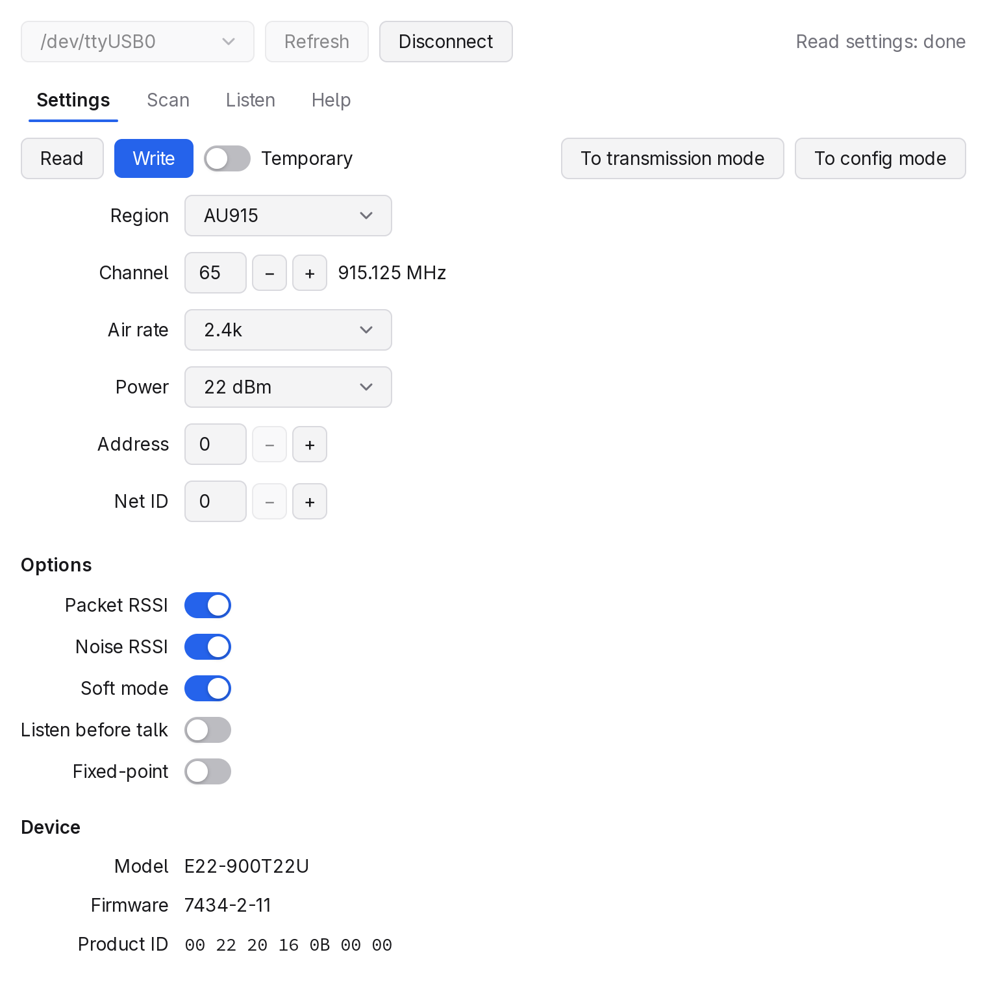
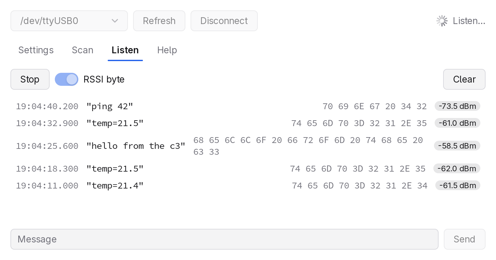

# e22-lora-tools

Open-source Linux tools for the **EBYTE E22-900T22U** USB LoRa dongle (SX1262,
850-930 MHz), replacing EBYTE's Windows-only RF_Setting.

- **`e22ctl`**: a command-line tool to read and write settings, scan the band
  for noise, listen for packets and transmit.
- **E22 Control**: a desktop app with the same features, built with
  [MyGo](https://github.com/egoist/mygo) native UI.
- **[PROTOCOL.md](docs/PROTOCOL.md)**: the dongle's configuration protocol,
  including behaviour the manual leaves out.

<p align="center">
  
</p>

Written in Go, with no cgo. Tested on Linux with an E22-900T22U running
firmware 7434-2-11. Other E22 T-series UART modules use the same register map
and probably work, but are untested.

## The dongle's two modes

The LED shows the mode. Hold the dongle's button for 1.5 s to switch.

| LED | Mode | |
|---|---|---|
| Red | Configuration | Settings can be read and written; nothing is transmitted |
| Green | Transmission | Bytes sent to the dongle are transmitted; received packets come back |

In transmission mode the dongle transmits **any** bytes it is sent,
configuration commands included. Run configuration commands in configuration
mode only.

Turning on **soft mode** lets software switch modes, and with **noise RSSI**
also on, the tools can tell which mode the dongle is in without transmitting.

## Command line

```sh
go install github.com/samcharles93/e22-lora-tools/cmd/e22ctl@latest
```

```sh
# Configuration mode (red LED)
e22ctl get                                  # show settings
e22ctl info                                 # plus model, firmware and product ID
e22ctl set -channel 65 -soft-mode on -noise-rssi on -packet-rssi on
e22ctl scan -from 65 -to 77                 # ambient noise per channel

# Transmission mode (green LED)
e22ctl listen -rssi                         # print received packets
e22ctl send 'hello'
e22ctl noise                                # ambient and last-packet RSSI

# Either mode, once soft mode and noise RSSI are on
e22ctl scan -any-mode
e22ctl mode config
```

Use `-port` to pick another device (default `/dev/ttyUSB0`) and
`e22ctl set -h` for every setting.

## Desktop app

It needs GTK 3, which most Linux desktops already have.

```sh
git clone https://github.com/samcharles93/e22-lora-tools
cd e22-lora-tools/gui
go tool mygo dev        # run with live reload
go tool mygo build      # build the app, .deb and .rpm into build/
```

Its tabs are Settings, Scan (a chart of noise per channel), Listen (a packet
log with a send box) and Help.

| Settings | Listen |
|---|---|
|  |  |

The screenshots show sample data. Regenerate them with
`CGO_ENABLED=0 go test -run TestScreenshots -screenshots .` in `gui/`.
 Pick your region on the Settings tab: the
channel field is marked when it leaves that region's licence-free band, and
Scan defaults to the band.

## Permissions

The dongle appears as `/dev/ttyUSB*` (CH340 USB-serial). Your user needs to be
in the `dialout` group, or your distribution's equivalent:

```sh
sudo usermod -aG dialout "$USER"   # then log out and back in
```

## Radio rules

Transmit only on frequencies, at powers and with duty cycles your local rules
allow. The region bands in these tools are approximate; check your
regulator's rules.

## Development

```sh
go test ./...                       # protocol and CLI
cd gui && CGO_ENABLED=0 go test .   # desktop app views, no window needed
```

The `e22` package holds the protocol. The tests use a fake serial port that
models the dongle's modes and its dropping of commands sent too quickly.

## Licence

MIT. EBYTE and E22 are trademarks of Chengdu Ebyte Electronic Technology Co.,
Ltd. This project is not affiliated with EBYTE.
